# 头部轮廓线探索：总结（2026-10，项目暂停）

写于 2026-10-29，分支 `exp/face-bones-3d`。这一段的目标、试过的每条路、数字、为什么不行，以及最后的讨论和 bowen 的判断。项目在这里暂停（bowen 1793259222 / 1793259542）。

## 目标

给转头 / 俯仰的人头，在**任意角度**拿到一套**干净、稳定、连续**的线：外轮廓（含下巴、脖子两侧）、下颌线、五官相关的线。最初的做法是画师画 0 / 45 / 90 几个关键帧（转头模型），效果好；这一段试的是能不能用 3D 模型（VRoid 头）来提供或约束这些线。

## 试过的路（按时间）

### 1. 头壳线框 → 外轮廓
- 做了「头壳标注」编辑器 `face3d/viewer/shelledit.html`：在 VRoid 头壳上加点、点之间连 bezier、取名、贴紧、使相交、导入现有线框；bowen 在上面画了整套线框（`face3d/viewer/ref-shell/bowen-1793118841-sym.json`：纬线、太阳穴、颧骨、下颌、颈上圈 线12、颈根圈 线11 等）。
- 用线框拼外轮廓（每条线提供一个切点，`face3d/fit/shell-outline.ts`，查看器 `shelloutline.html`）：bowen「这个太失败了」。
- 0–30° 按角度混合脸轮廓和太阳穴·颧骨线（`shell-rule.ts`）；暂时把耳朵压平（`flatten-ears.ts`）。

### 2. 用 VRoid 轮廓做参考
- 每 10° 把「内 2 外 3」那套线拟合到 VRoid 轮廓上（`vrm-five.ts`），rms 0.008–0.010。
- 旧转头模型展示间 `turnshow.html`；按旧模型脸轮廓反推捏脸的 VRoid 副本（`sculpt-to-model.ts`, `sculpt.html`）。
- 两种头壳 fit 进 dot 生成过的图（`shells-on-dot.ts`）：平视的能对上；±45° 俯仰那几张对不上任何 3D 头。

### 3. 压扁鸟笼
- 每个角度的 VRoid 轮廓沿视线压扁放进自己的平面（`vrm-flat-cage.ts`, `flatcage.html`），转头笼子和各转角下的俯仰笼子可复选叠加。发现转头笼子和俯仰笼子的形状完全不一样。

### 4. f(yaw, pitch) = 轮廓：15° 关键帧 + 四角混合（bowen 1793153948）
- 13×13 = 169 个关键帧（转头 × 俯仰 −90…90，每 15°），每个 = VRoid 屏幕轮廓 2×180 点（从头顶顺时针，按弧长）；任意角度 = 周围 4 个关键帧双线性混合（`contour-keys-core.ts`, `contour-keys.ts`, 查看器 `contourkeys.html`，提交 093bc73b）。
- 平顺：混合每 0.5° 一步的变化几乎恒定（相邻步之差 0.0000），实时轮廓 0.0012；但实时轮廓只看形状本来也不抖（每步最大 0.0054，约头高 0.2%），之前看到的大尖峰是点沿线滑动。
- 准：关键帧之间一般偏 0.005–0.01，最差 0.03–0.07（鼻子、嘴、脖子截口），鼻尖嘴唇被混平。

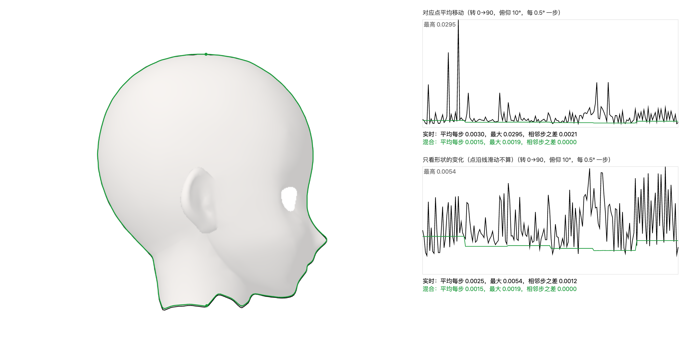
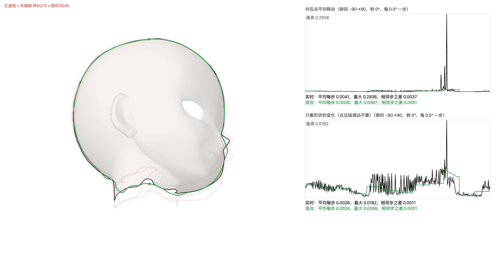

### 5. 最少要多少关键帧（bowen 1793155191 / 1793155230）
- 每 1° 一个角度（181² ≈ 3.3 万）算 VRoid 轮廓当标准答案；关键帧从四角开始，每次加在「混合最差」的角度，三角形（Delaunay）重心混合（`contour-adaptive.ts`, `delaunay.ts`, 查看器 `contouradaptive.html`）。偏差 = 两条线之间最远的地方（头高约 2.4）。
- 结果（关键帧数，0.05 档 / 0.02 档）：

| 版本 | 0.05 | 0.02 |
|---|---|---|
| 整个头（头顶/底部 2 点对齐，截口也量） | 1701 | 4393 |
| 整个头（头顶/底部 2 点对齐，截口不量） | 1666 | 4224 |
| 整个头（8 点对齐，截口不量） | 1516 | 4351 |
| 整个头，下巴以下不量 | 1341 | 3662 |
| 头壳（鼻子嘴压平） | 1207 | 3156 |
| 头壳，下巴以下不量 | 1053 | 2500 |
| 长筒脖子 + 画圆截断 | 1587 | 4009 |
| 头壳 + 长筒脖子 + 圆截 | 1230 | 2824 |

- 关键帧挤在哪：先是「仰 30°～60°、所有转角」那条带：下巴下面左右露出的细脖子边忽隐忽现，一冒出来整段点都挪位（光「不量」不够，要从轮廓里去掉）；去掉后是正面附近（长筒和下巴接缝的网格小洞）和正上/正下方（那里转头 = 整张图打转，屏幕方向的对齐点跟着滑走）。

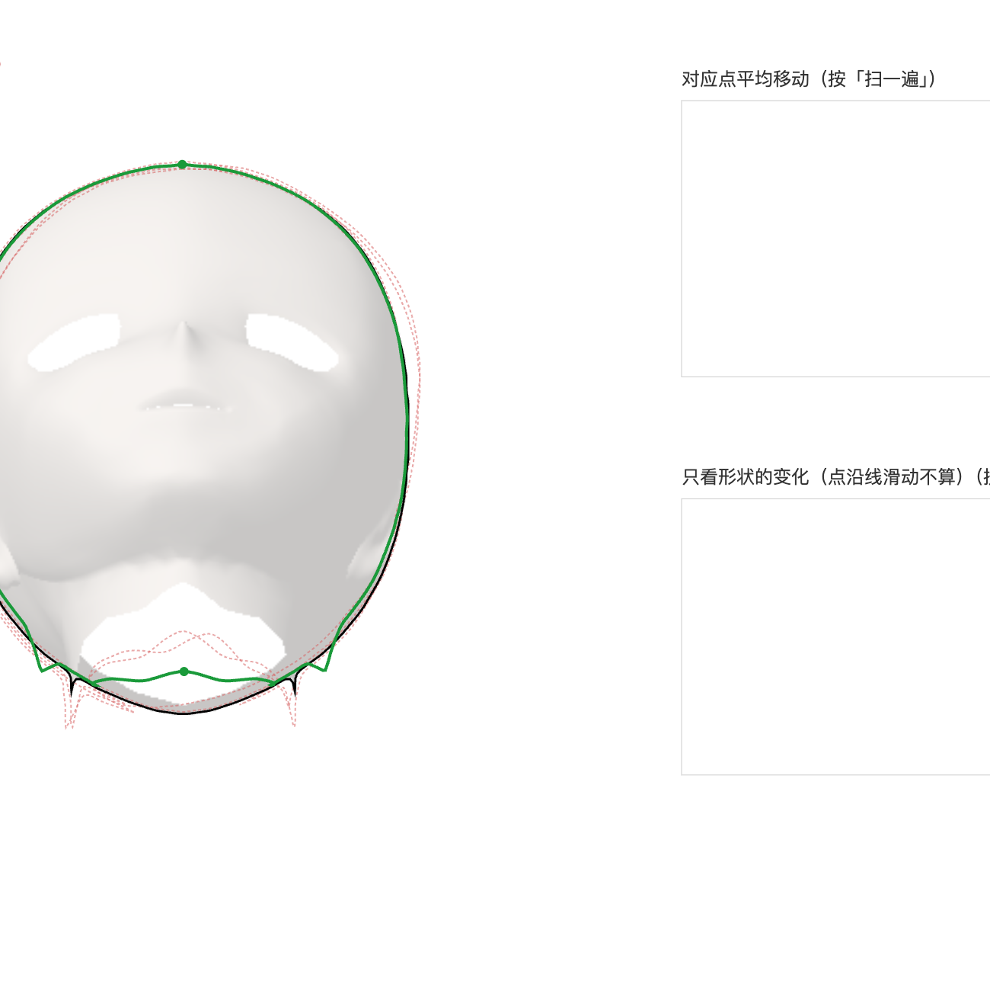

### 6. 拆部件（bowen 1793155916 / 1793156407 / 1793156931 / 1793156971 / 1793157014）
- 鼻子嘴压平到周围脸面拟合的光滑面上 = 头壳，压掉的薄体积 = 鼻子嘴那一块（`flatten-face.ts`）；理论上两块轮廓合起来 = 整个头轮廓。
- 脖子：VRoid 下巴以下网格很糙（喉咙有洞，脸皮到 −1.49 就没了）。按 bowen 画的两圈分：头沿颈上圈（线12）切开封口，脖子 = 颈上圈到颈根圈（线11）的筒，完全用他画的线做（`neck-split.ts`, 查看器 `noseparts.html`）。仰视时头的下边就是下颌线。脖子只有两条侧线重要，收口线不重要（bowen 1793157014）。

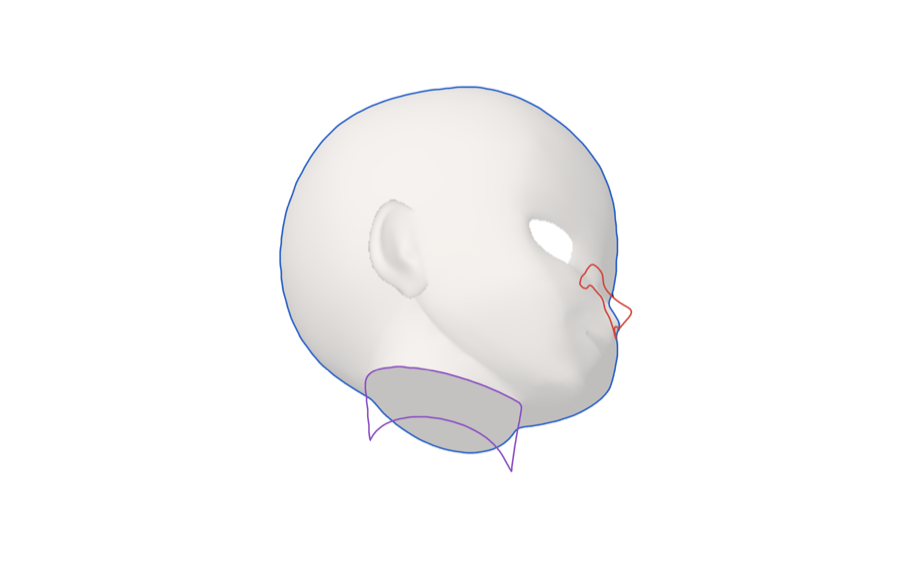
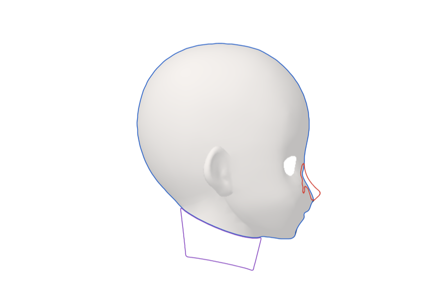

### 7. bowen：应该像头环一样「转动」（1793157748）
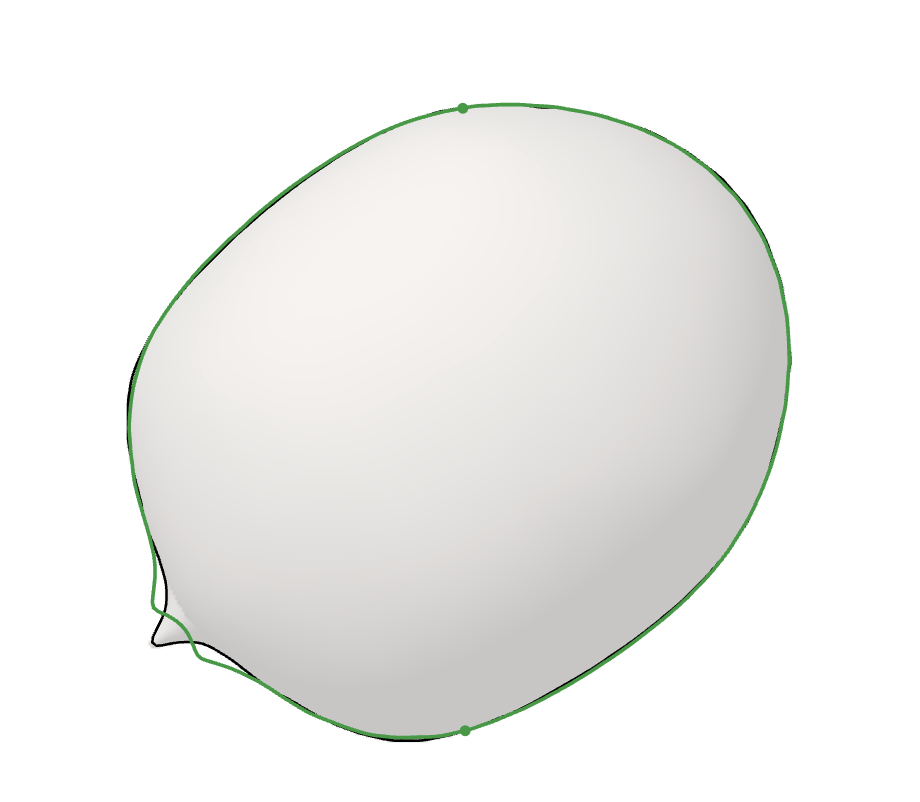

这个角度的外轮廓就是头壳上的一圈 3D 线，转动它就能 fit 附近角度，而不是混合平面折线。随后的讨论（1793157975 起）：

- **正上方俯视的旋转等变**：俯 90° 时转头 = 绕视线转，轮廓形状完全不变，只是图转（差 ≤0.006，像素噪声）。俯 85°：转头 = 图转 sin85°×Δ + 视线歪 5°；转 90° 时图只转 87.9°，剩余差 0.056；俯 75°：图转 79.9°，剩余 0.17。正负转左右镜像：正转时「后脑→一侧」那半边往外鼓、另一半往里缩，脸那边下巴/鼻尖时隐时现。

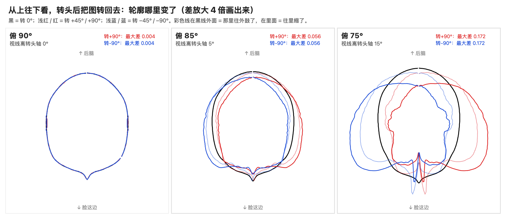

- **偏差 = 视差形变 + 局部换点**：把转 0° 时轮廓贴在头上的那圈 3D 线（带深度）直接转过去：俯 85° 中位偏差从 0.021–0.032（平面图转回去）降到 0.007–0.009，俯 75° 转 45° 从 0.042 降到 0.013 → 大部分是视差（每个点按它的深度挪，可以看成和 yaw pitch 挂钩的域形变）。剩下的集中在局部：轮廓换成了头上另一批点（俯 75° 转 90° 侧面一大段），最大差反而变大（0.078 / 0.200）。

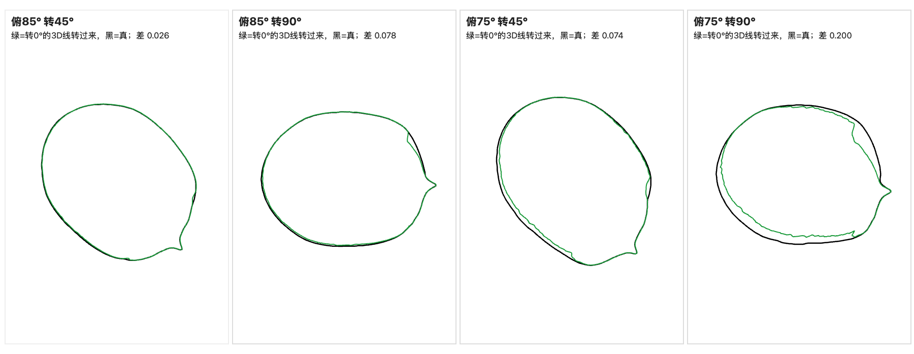

- **bowen 提出的结构**（1793162822，未验证）：换点 = 把模型拆成部件，各自视差形变，谁覆盖谁形成换点；一个 pitch 一圈 yaw，每圈靠「视差形变 + 局部换点」；不同 pitch 之间选关键 pitch 插值。补充的一点：同一个光滑部件上轮廓线本身也会在表面上滑（不是遮挡），这种只能在那一圈上多放关键帧。

### 8. 只用 4 视图（正、侧、顶、底）能恢复什么（bowen 1793202393 / 1793202424）
- 俯视和仰视的外轮廓在正交投影下是镜像，4 视图只有 3 个独立轮廓。只凭外轮廓能恢复的最大形状 = 三个方向挤出的柱子的交集（视觉外壳）。三个视图上必然一致，中间角度全都「方」了：斜方向没有图去削它。制图里三视图能定物体，是因为还画了内部线，零件多是平面和正对坐标轴的圆柱。

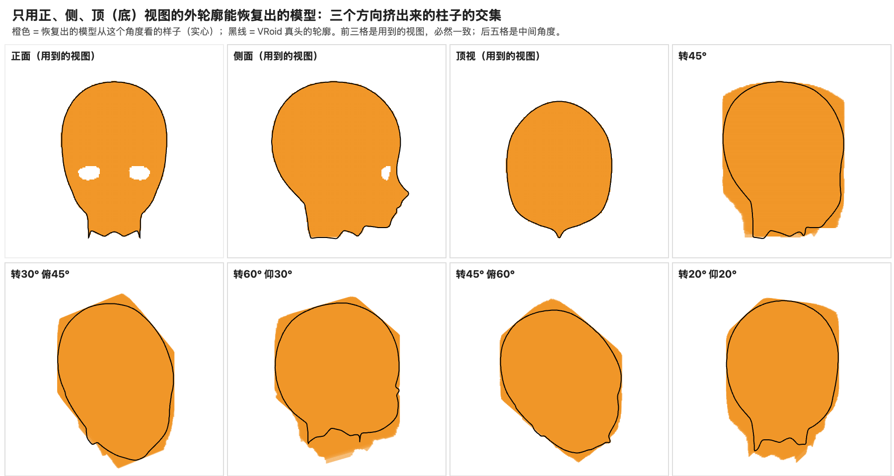

### 9. 直接在模型表面上算轮廓（bowen 1793202978）
- 每个顶点算「法线朝不朝向眼睛」，轮廓 = 正好侧着的那条线，在三角形边上插值连线，再按深度（沿法线外移一点测试）去掉被挡住的（`smooth-contour.ts`, 查看器 `smoothcontour.html`）。没有像素锯齿，转动时连续，耳廓、鼻尖、下巴自动出来。

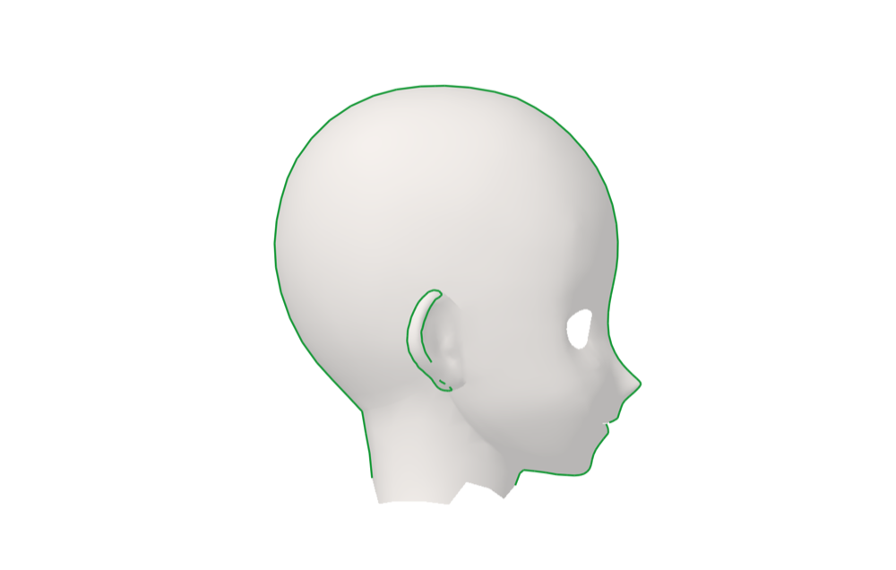
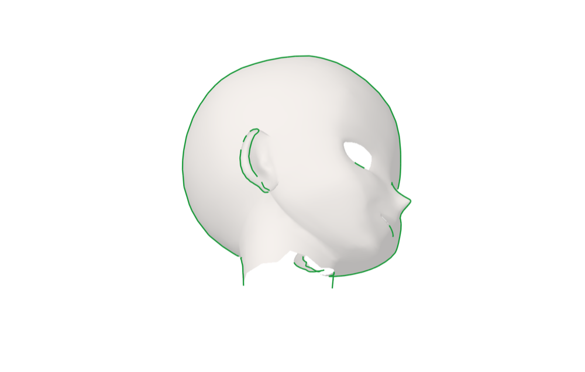
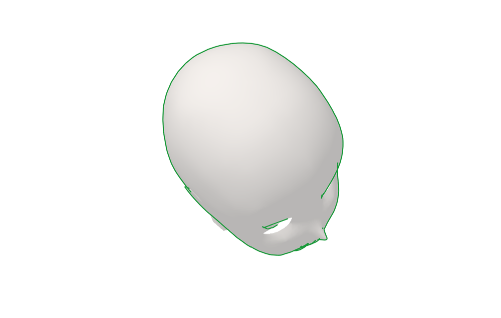

- bowen（1793203190）：以前做过，这种线在模型特定位置不连续，而且在模型上的真实位置非常扭曲。原因：①平、直的地方（脸颊、侧脑）视线稍变，贴着轮廓的点就在表面上滑很远，3D 位置天生不稳（屏幕上的投影是稳的）；②断分两种：真的断（绕到别的东西后面，画画也该是 T 字收口），和网格太粗造成的假断。

## 结论（bowen 1793203934 / 1793203985 / 1793259222）

- 这些都不优雅。从 3D 模型自动拿出好看的轮廓线本来就没有优雅解：3D 模型的轮廓天生是一条在表面上滑的线，所有卡通渲染的描线都带着这个毛病。
- 这一段唯一明显更优、有意义的策略是**骨线形变代替 Live2D 的变形器**。但它本质上还是变形器的一种表现形式，只是有名字、可能能挂 3D 骨骼做更多「编辑」；变形器的形状和拓扑跟着每张画固定，依旧没法大规模通用复用。
- 这样的话工作流等于：一张大致立绘 → bezier 描图 → 附近像素挂载，本质上就是 Live2D 的工作流。
- 这个东西大概只在做动画或漫画时有用（比 AI 更可控、保持性更好）；对互动视频 / 视觉小说（一张张立绘、没什么特别动作），AI 生产线（火柴人指示动作）已经够用。等 AI 掌握了分图层（amodal）和角度保持性，这个方向注定被干碎。
- 决定：项目暂停，bowen 转去写视觉小说剧本。

## 如果将来要继续

- 线永远来自画师，3D 只做骨架和参考（哪里露、转多少），而不是线的来源：0 / 45 / 90 关键帧那套当初效果最好，是后来想用 VRoid 轮廓替代画师的线才越做越不优雅。
- 颅骨用几何体（椭球）定义：任何角度轮廓是解析的椭圆，绝对光滑；下颌、脸、鼻子用画师的线。
- 骨线形变（core/v1 里的 骨骼线 / 绑骨）是这段最值得保留的东西。

## 代码与数据

- 查看器（`face3d/viewer/`，在 5192 上打开）：`shelledit.html`, `shelloutline.html`, `vrmyaw.html`, `turnshow.html`, `sculpt.html`, `flatcage.html`, `contourkeys.html`, `contouradaptive.html`（`?a=8` 等选版本，需要先跑出对应 json）, `noseparts.html`（`?neck=wire|tube|cap|cut`）, `smoothcontour.html`。
- 脚本（`face3d/fit/`）：`contour-keys-core.ts`（头的构建：耳朵 / 鼻子嘴压平、脖子 cut / tube / cap / wire；轮廓提取：锚点、spin、3D 线）, `contour-keys.ts`, `contour-adaptive.ts`（环境变量 A / PART=head|shell|nose|neck / NECK / LONG / CAP / WIRE / SPIN / RIM）, `delaunay.ts`, `flatten-ears.ts`, `flatten-face.ts`, `neck-split.ts`, `smooth-contour.ts`。
- 没有上传的（可重新生成）：`face3d/viewer/contour-adaptive*.json`（每个约 32 MB，`npx vite-node face3d/fit/contour-adaptive.ts` 加对应环境变量重跑，3.3 万个角度的标准答案缓存在系统临时目录）；`bench-tasks/**/.*.bmp`（参考图的原始位图）。
- 手调数据：`bench-tasks/`（各轮参考图、手调存档、备份）和 `脸轮廓手调/`。
